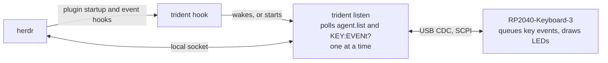

# herdr-triton specification

English | [日本語](ja/spec.md)

When a herdr agent is waiting for approval (`blocked`), the three keys of an RP2040-Keyboard-3 jump to it, move the highlight among its options, and confirm the highlighted one. The RGB LED under each key shows how many agents are waiting and whether Approve would act.

## Architecture



| Component | Responsibility |
|---|---|
| `firmware` | Queues debounced key events and answers `KEY:EVENt?`. Draws the LEDs it is told to. Detects a missing host. Makes no herdr decisions |
| `trident` | Polls herdr for a snapshot of all agents and the device for key events, holds the state, turns key input into herdr requests, and decides the LED output |
| `protocol` | Message types shared by `firmware` and `trident`, and their SCPI text form. `no_std` |
| `keypad` | The firmware's hardware-free core. `no_std` |
| plugin | `herdr-plugin.toml`: starts `trident hook` from herdr's startup and event hooks |

The device is an IO instrument on a serial line, not a HID keyboard. Key input reaches `trident` over serial only.

## Listener lifecycle

A resident `trident listen` serves the keypad for the life of the herdr server that started it (ADR 0012).

| Given | When | Then |
|---|---|---|
| any | herdr runs the plugin's `startup`, or emits `pane.agent_status_changed` | herdr starts `trident hook` |
| a listener holds the named mutex | `trident hook` starts | it sets the listener's wake event and exits |
| no listener | `trident hook` starts | it finds the keypad's port, spawns `trident listen --port <port>` and exits; with no keypad it just exits |
| listener | it starts and the mutex is already held | it exits |
| listener, quiet | the wake event is set, or a key goes down | it takes a snapshot and becomes active; a key is then handled on that snapshot |
| listener, active | `queue` and `done` have both been empty for 5 s | it becomes quiet |
| listener, active | herdr has been unreachable for 5 s, or its version is not supported | it exits |
| listener, quiet | herdr's endpoint has been missing for 5 s | it exits |
| listener | `trident stop` sets the stop event | it exits |
| listener | the keypad fails or disappears | it closes the port and runs `trident find-port` every second until the keypad is back |

| Mode | Requests to herdr | `KEY:EVENt?` | LEDs |
|---|---|---|---|
| quiet | none; every second it checks that herdr's endpoint exists, without connecting | every 250 ms | Jump's LED breathing white, the others off |
| active | `agent.list` every 250 ms and after each request | every 20 ms | as in "LEDs" |

On Windows, the mutex, wake event and stop event are named after the user session (`Local\herdr-triton-listener`, `-wake`, `-stop`). Before spawning, `trident hook` clears `HANDLE_FLAG_INHERIT` on its standard handles, since herdr counts a hook as running until its stdout and stderr close. The listener is created with `DETACHED_PROCESS` and `CREATE_NEW_PROCESS_GROUP`, with its working directory set to the plugin's state directory, and logs there to `trident.log`. It starts `trident find-port` with `CREATE_NO_WINDOW`, since a console program started from a process without a console otherwise opens a console window.

The first herdr session whose hook starts a listener keeps the keypad until its server stops. `trident run` runs the active loop without quiet mode or exit rules, for use without the plugin. With no listener, the device is in `NoHost` and shows dim white.

### Memory

The listener stays at or under 1 MB in Task Manager's Memory column (active private working set), taken as the highest value over a 1 h run. To that end it links the C runtime statically, talks to herdr over `std` named pipes instead of `interprocess`, decodes herdr's replies into typed structs without `serde_json::Value`, and never enumerates serial ports itself. The `trident` executable delay-loads `setupapi.dll`, `cfgmgr32.dll`, `advapi32.dll`, `bcryptprimitives.dll` and `user32.dll`, which only port enumeration, hashing with a random seed and `trident raise` call, so a listener loads none of them; its own maps are ordered maps, which need no seed.

## herdr

### Requirements

- herdr 0.9.1 or later. Earlier versions do not move the attached client on `agent.focus` and do not report manual focus changes
- `trident` runs as the same OS user as herdr

`trident` sends `ping` on connect and treats a `version` below 0.9.1 as `Incompatible`.

### Connection

herdr's API accepts one request per connection: the server reads the first line and answers it. `trident` opens a new connection for every request. Each request has a 2 s deadline; a request that misses it counts as failed. Whenever the loop becomes active, and after herdr becomes reachable again, `trident` sends `ping` before its next snapshot. A listener that gets an unsupported version exits; `trident run` shows `Incompatible`.

One `trident` serves one herdr session (ADR 0007). `trident --session <name>` picks it by name, `default` being the default session, and wins over the environment, as herdr's own `--session` does. Without `--session`, the socket path is resolved as herdr resolves it, in this order:

1. `HERDR_SOCKET_PATH`
2. `HERDR_SESSION`, giving `<config>/sessions/<name>/herdr.sock`
3. `<config>/herdr.sock`

`<config>` is `$XDG_CONFIG_HOME/herdr` when set, otherwise `%APPDATA%\herdr` on Windows and `~/.config/herdr` elsewhere. On Windows the path string names a named pipe, `\\.\pipe\<path>` (as interprocess `GenericNamespaced` maps it for herdr), and the file at that path is only a marker. `trident` opens it with `std`, and when every pipe instance is busy it waits for one with `WaitNamedPipeW`. A quiet listener checks the pipe with `WaitNamedPipeW` alone, which does not connect: the pipe exists when an instance is free or the wait times out. On Unix it checks that the socket file exists.

herdr sets `HERDR_SOCKET_PATH` inside its own panes, so a `trident` started from a herdr pane talks to that pane's session whatever `HERDR_SESSION` says.

### Requests used

| Request | Use |
|---|---|
| `ping` | Version check on connect |
| `agent.list` | Snapshot of every agent: `pane_id`, `agent`, `agent_status`, `focused`, `state_change_seq` |
| `agent.focus {target}` | Jump. Switches workspace and tab and focuses the pane. Replies with `agent_info`, not `ok` |
| `agent.send_keys {target, keys}` | Approve and Select. herdr rejects it if the pane no longer hosts the same agent |
| `agent.read {target, source: "visible"}` | Select, for an agent whose list does not wrap: the screen, to find the highlight |

`trident` does not use `events.subscribe`. See ADR 0004.

## Deployment

`trident` runs on the machine the device is plugged into, and must reach herdr's socket from there.

| herdr runs on | trident runs on | Path to herdr |
|---|---|---|
| Windows | Windows | named pipe |
| Linux / macOS, same machine | same machine | Unix socket |
| WSL 2 | WSL 2, with the device attached by `usbipd attach --wsl --auto-attach` | Unix socket |
| Remote host over SSH | local machine | Unix socket forwarded with `ssh -L` |

Only Windows is supported for now, and the plugin declares `platforms = ["windows"]`. The other rows are where `trident` is meant to run once the listener has Linux and macOS equivalents; none of them is verified.

## Hardware

| Item | Value |
|---|---|
| MCU | RP2040, 12 MHz crystal |
| Flash | W25Q16JV, 2 MB (`BOOT_LOADER_W25Q080`) |
| Keys | switch to GND, internal pull-up, low when pressed |
| RGB LEDs | 3 × WS2812B, data on GP18, **RGB** byte order, chained L1 → L2 → L3 |
| GP25 | A single red LED, not used |
| USB | Two Type-C ports behind a mux. Connect one only |

Seen from above, keys in a row:

| Position | Key GPIO | LED |
|---|---|---|
| left | GP14 | L1 (first in chain) |
| middle | GP13 | L2 |
| right | GP12 | L3 |

The LEDs take RGB, not the GRB that Waveshare's FastLED demo declares and `ws2812-pio` sends. The firmware swaps red and green before writing.

## Keys

| Default position | Name | Action |
|---|---|---|
| left | Jump | Move between waiting panes; with none, between agents that have finished; with none of those either, between every agent (ADR 0011). Held for 500 ms, it also brings herdr's window to the front (ADR 0015) |
| middle | Approve | Confirm the highlighted option of the focused prompt |
| right | Select | Move the highlight of the focused prompt to the next option, from the last back to the first. With `select_hold = "up"`, holding it for 500 ms moves the highlight up instead (ADR 0017) |

To approve, press Jump, then Approve. To pick another option, such as rejecting, press Select until it is highlighted, then Approve. See ADR 0006.

`layout` in "Configuration" moves the keys to other positions (ADR 0013). A key takes its LED along: the LED above a key shows that key's state as in "LEDs", and flashes for it.

## Configuration

`trident` reads `config.toml` from the plugin's configuration directory: `HERDR_PLUGIN_CONFIG_DIR` when herdr sets it, otherwise `<config>/plugins/config/shortarrow.herdr-triton`, with `<config>` as in "Connection". `herdr plugin config-dir shortarrow.herdr-triton` prints it.

```toml
layout = ["jump", "approve", "select"]
select_hold = "none"
```

| Field | Value | Default |
|---|---|---|
| `layout` | The keys at the left, middle and right position: `"jump"`, `"approve"` and `"select"`, each once | `["jump", "approve", "select"]` |
| `select_hold` | What holding Select for 500 ms does: `"none"`, nothing, and Select acts when it goes down; `"up"`, send the back keys once, and a short Select acts when it comes up (ADR 0017) | `"none"` |

| Given | Then |
|---|---|
| No file | The defaults |
| The file does not parse as TOML, `layout` is not one of each name, or `select_hold` is neither `"none"` nor `"up"` | The defaults, and a log line saying why |
| A field this table does not name | Ignored |

`trident` reads the file once when it starts; a listener keeps the configuration it started with until `trident stop`.

## trident state

| Name | Type | Meaning |
|---|---|---|
| `conn` | `Disconnected \| Incompatible \| Connected` | Reachability of herdr |
| `device` | `Absent \| Present` | Whether the serial port is open |
| `queue` | sequence of `(pane_id, agent, state_change_seq)` | Agents in `blocked`, in the order `trident` first saw them blocked |
| `focused` | `pane_id` or none | The agent pane herdr reports as `focused` |
| `sent` | set of `(pane_id, state_change_seq)` | Confirmations sent and not yet followed by a state change |
| `done` | sequence of `pane_id` | Agents in `done`, finished and not yet seen, in `agent.list` order |
| `agents` | sequence of `pane_id` | Every agent, in `agent.list` order |
| `lapsed` | set of `(pane_id, agent)` | Entries that left `queue` because their pane turned `idle`, kept while it stays `idle` (ADR 0016) |

Invariants:

- A `pane_id` appears in `queue` at most once
- Every entry in `queue` was `blocked` in the latest snapshot
- Every entry in `sent` matches an entry of `queue` in both `pane_id` and `state_change_seq`
- Every entry in `lapsed` was `idle` in the latest snapshot and is not in `queue`

`approvable(p)` holds when `p` is in `queue`, `p` is `focused`, the entry's `agent` has prompt keys configured, and `(p, seq)` is not in `sent`.

`lapsed_focus(p)` holds when `p` is in `lapsed`, `p` is `focused`, and the entry's `agent` has prompt keys configured.

## Behaviour

### Event loop

Key events and snapshots are handled one at a time in a single loop. A key press is handled after the requests of the previous one, including their refresh, have finished.

### Snapshot

`trident` calls `agent.list` every 250 ms and after every request it sends. Applying a snapshot:

| Given | Then |
|---|---|
| Entry in `queue`, now `idle`, `(pane_id, seq)` not in `sent` | Remove it and add it to `lapsed` |
| Entry in `queue`, absent from the snapshot or not `blocked`, otherwise | Remove it |
| Entry in `lapsed`, absent from the snapshot or not `idle` | Remove it |
| Entry in `queue`, still `blocked`, `state_change_seq` changed | Keep its position, update `agent` and `state_change_seq` |
| `blocked` in the snapshot, not in `queue` | Append it. On the first snapshot after connecting, append in `agent.list` order |
| any | `focused` = the agent with `focused: true`, or none |
| any | `done` = the agents in `done`; `agents` = every agent |
| any | Drop from `sent` every entry that no longer matches `queue` |

A failed `agent.list` sets `conn = Disconnected` and clears `queue`, `focused`, `sent` and `lapsed`. `trident` keeps retrying.

### Keys

| Given | When | Then |
|---|---|---|
| `conn ≠ Connected` | any key | error flash |
| `queue` not empty, `focused ∉ queue` | Jump | `agent.focus` the head, refresh |
| `queue` not empty, `focused ∈ queue` | Jump | `agent.focus` the entry after `focused`, cycling, refresh |
| `queue` empty, `done` not empty | Jump | as the two rows above, over `done` |
| `queue` and `done` empty | Jump | as the first two rows, over `agents`; error flash if there are none |
| any | Approve | Refresh. If `approvable(focused)`, `agent.send_keys` the confirm keys and add `(focused, seq)` to `sent`; otherwise error flash |
| `select_hold = "none"` | Select | Refresh. If `approvable(focused)`, move the highlight as in "Prompt keys". Else if `lapsed_focus(focused)`, read the screen with `agent.read`: if it shows a highlighted numbered list, move the highlight as in "Prompt keys", otherwise error flash. Otherwise error flash |
| `select_hold = "up"` | Select comes up within 500 ms of going down | As the row above |
| any | a request fails | error flash, refresh. A failed confirmation is removed from `sent` |
| `select_hold = "up"` | Select has stayed down for 500 ms | As the short Select, sending the back keys once instead of moving to the next option. Once per press; its release does nothing |
| any | Jump has stayed down for 500 ms | `trident raise`; success flash if it raised a window, otherwise error flash. Once per press |

Jump does not reorder `queue`. When `queue` has one entry and it is focused, Jump focuses it again.

Approve and Select refresh the snapshot right before deciding, so the decision uses state at most one request old. `sent` stops a second press from confirming the same prompt again, or a prompt that replaced it, before herdr has reported a state change. It also stops Select, so that an arrow key never lands in an agent's input box after the prompt has closed.

### Raising herdr's window

`trident raise` brings the window that shows herdr to the front and exits with success if that window is then in front:

1. Take each herdr client in turn: a `herdr.exe` whose parent is not `herdr.exe`. The server is started by a client, and a process snapshot does not carry command lines
2. Walk up from the client, itself included, through its parents to the first process that owns a visible top-level window without an owner window; the first client that leads to one wins. In WezTerm that is `wezterm-gui`, since the client's pseudo console has no owner window
3. If that window is minimised, restore it
4. Attach to the input thread of the window in front with `AttachThreadInput`, call `SetForegroundWindow` and `BringWindowToTop`, then detach. Windows refuses `SetForegroundWindow` alone from a process that did not receive the last input

The listener starts it with `CREATE_NO_WINDOW`, as it starts `trident find-port`, so that only this short-lived process loads `user32.dll`.

### Prompt keys

Keyed by herdr's agent id. They are built in; "Configuration" does not carry them yet.

| Agent id | Confirm keys (default) | Select keys (default) | List wraps | Back keys (default) |
|---|---|---|---|---|
| `claude` | `["enter"]` | `["down"]` | no | `["up"]` |
| `codex` | `["enter"]` | `["down"]` | yes | `["up"]` |

Codex's list moves from its last option to its first on `down` (openai/codex `1cc7e23`, `scroll_state.rs`, `move_down_wrap`); Claude Code's stops at the last. For an agent whose list does not wrap, Select reads the pane's visible screen with `agent.read` and finds the numbered options and the highlighted one (ADR 0010):

| Given | Then |
|---|---|
| The highlight is on the last of `n` options, `n ≥ 2` | Send the back keys `n − 1` times |
| Otherwise, or the screen shows no highlighted numbered list, or `agent.read` fails | Send the select keys |

The screen decides only where Select moves the highlight, and whether Select acts on a lapsed pane; whether Approve may confirm never depends on it.

herdr 0.9.3 reports a Claude Code question prompt as `idle` while its highlight is on "Type something.". `lapsed` keeps Select working there; Approve and the LEDs ignore `lapsed` (ADR 0016).

Both agents show their approval prompts as a list whose highlight moves with the arrow keys and is confirmed with `enter`. Codex also accepts `y`, but `y` picks "yes" whatever is highlighted, so it is not used.

## LEDs

The steady LED output is a function of `(conn, device, len(queue), len(done), approvable(focused))`. A one-shot flash for a key press is drawn on top.

| State | Jump | Approve | Select |
|---|---|---|---|
| `Disconnected` | red, slow blink | red, slow blink | red, slow blink |
| `Incompatible` | red, solid | red, solid | red, solid |
| `queue` empty, `done` not empty | green, breathing | off | off |
| `queue` and `done` empty | white, breathing (Jump cycles every agent) | off | off |
| `queue` has 1 | orange, breathing | green if `approvable(focused)`, otherwise off | blue if `approvable(focused)`, otherwise off |
| `queue` has 2 or more | reddish orange, breathing | as above | as above |

Flashes:

- Success: the pressed key flashes white once. It means herdr accepted the request, not that the agent proceeded
- Invalid action or error: the pressed key flashes red once

## firmware

### No-host state

The firmware is in `NoHost` while DTR is low, or when no command has arrived from the host for 3 s. In `NoHost` it:

- discards key events instead of queueing them, and empties the queue on entering
- shows a dim white on all three LEDs

A command that arrives while DTR is high ends `NoHost`; the LEDs then show their last set state, dark after power-up. A listener polls `KEY:EVENt?` at least every 250 ms, which keeps the device out of `NoHost`.

### Keys

A key reports `Down` or `Up` once its level has stayed the same for 5 ms. Reported events wait in a queue of 16 until the host reads them; an event that finds the queue full is dropped and records error -350.

### Rendering

| Mode or state | Output |
|---|---|
| `Solid` | The colour |
| `Off` | Dark |
| `Blink` | The colour for 500 ms, dark for 500 ms |
| `Breathe` | The colour, its brightness rising from 10 % to 100 % and back over 2 s |
| `Flash` | The flash colour on that key for 150 ms, over whatever it showed |
| `Wave` | For checking the LEDs; `trident` does not use it. A rainbow that moves across the keys: LED `n` shows hue `360° × t / 3 s + 120° × (n − 1)` at full saturation, its brightness breathing as `Breathe`; the colour sent is ignored |
| `NoHost` | White at 8/255 on all three |

Every colour is scaled so that full brightness is 64/255; WS2812s at full power are uncomfortable to look at. The LEDs take RGB and `ws2812-pio` sends GRB, so the firmware swaps red and green last.

### Invariants

- The main loop never blocks for more than 1 ms. A write that would block is dropped
- Animations are driven by comparing a timer each loop, never by delays

### Identification

The USB serial number is `TRITON-` followed by the flash unique ID in hex, and the product string is `herdr-triton`. `trident` finds the device by the `TRITON-` prefix of the serial number, ignoring case: on Windows `serialport` reports a CDC port's serial number, upper-cased, but gives the port's display name in place of the product string. The VID/PID is not used for identification.

### USB composition

CDC serial and `drooling::PicotoolReset`, built with `usb_rev(Usb210)`, `max_packet_size_0(64)`, `composite_with_iads()` and `LangID::EN_US`. `drool run` needs exactly one reset-capable device attached.

The device uses Raspberry Pi's VID `0x2E8A` with the Pico SDK's CDC PID `0x000A`, as drooling's examples do. It is a hobby device built from this repository and not sold, so it takes no PID of its own. Nothing depends on the pair: `trident` finds the keypad by its `TRITON-` serial number, and `drool` finds the reset interface by its descriptors.

## firmware ↔ trident protocol

Carried over USB CDC-ACM as SCPI-style text, one command per line (ADR 0009). The host sends commands; the device answers queries only and never speaks unasked, so any serial terminal can drive it.

- Lines end with `\n`; a preceding `\r` is ignored. A line is at most 64 bytes
- Headers are case-insensitive and accept the long form or the short form in upper case in this table (`EVENt` accepts `EVEN` and `EVENT`)
- `<n>` is `1`, `2` or `3`, left to right; `<rgb>` is `#RRGGBB`; `<mode>` is `OFF`, `SOLid`, `BREathe`, `BLINk` or `WAVe`
- Commands without `?` produce no reply. Each query produces one line

| Command | Reply | Meaning |
|---|---|---|
| `*IDN?` | `ShortArrow,herdr-triton,<serial>,<firmware version>` | Identify the device |
| `SYSTem:PROTocol?` | `3` | The protocol version; 3 added `WAVe` |
| `SYSTem:ERRor?` | `<code>,"<message>"` | The oldest queued error, or `0,"No error"` |
| `LED:ALL <rgb>,<mode>,<rgb>,<mode>,<rgb>,<mode>` | | Set every LED, left to right |
| `LED<n> <rgb>,<mode>` | | Set one LED |
| `LED<n>:FLASh <rgb>` | | Flash one LED once |
| `KEY:EVENt?` | `LEFT,DOWN`, …, `RIGHT,UP`, or `NONE` | Take the oldest queued key event |

Errors are queued, up to 8, and read with `SYSTem:ERRor?`:

| Code | Message | When |
|---|---|---|
| -100 | `Command error` | A line that does not parse |
| -113 | `Undefined header` | An unknown header |
| -222 | `Data out of range` | An LED number, colour or mode that is not valid |
| -350 | `Queue overflow` | A key event or error that found its queue full |

The `protocol` crate holds the typed commands and replies and their text form, used by both ends.

`trident` sets DTR on opening the port, discards input already buffered, and asks `SYSTem:PROTocol?`. On a version other than its own it closes the port and reports the mismatch. It then sends `LED:ALL` on every change and at least once per second, and polls `KEY:EVENt?` as in "Listener lifecycle" until it answers `NONE`.

## Dependencies

| Crate | Version | Reason |
|---|---|---|
| `rp2040-hal` | 0.11 | `ws2812-pio` 0.9 does not build against 0.12 |
| `usb-device` | 0.3 | Required by `drooling` and `usbd-serial` 0.2 |
| `windows-sys` | 0.59 | Named mutex and events, `WaitNamedPipeW`, handle inheritance, process creation flags, and the process snapshot and window calls of `trident raise` |
| `toml` | 0.9 | Reads `config.toml`, with only its parser and serde support |
| `serialport` | 4 | Lists ports with their USB serial numbers on Windows, Linux and macOS |

The plugin requires a herdr with plugin support (`min_herdr_version` 0.9.1, the version this specification requires anyway).

## Unspecified

- Agents on other machines that a herdr client shows alongside local ones (`herdr machine`). `trident` reads only the local server's API, and neither server's API says which machine the client has in focus
- Long-press actions other than Jump's and Select's
- Which window `trident raise` brings forward when several herdr clients run, or when the terminal process has several windows
- How `done` is shown
- A minimum time a pane must stay approvable before Approve acts, so that a press already on its way does not answer a question that just appeared
- Clearing `sent` when herdr never reports a state change after an approval
- Linux and macOS equivalents of the listener's mutex, events and detached spawn. Until then the plugin declares Windows only; a `trident hook` built there serves the keypad in its own process, which herdr counts as a running hook, and exits when the keypad fails
- Which client's view `focused` reflects when several herdr clients are attached
- Several devices at once
- A network transport: CDC-NCM with raw SCPI on TCP port 5025, reachable from VISA as `TCPIP::<address>::5025::SOCKET` and from telnet or nc. It waits for `drooling` to support `embassy-usb`, which has an NCM class; the SCPI commands and their parser stay as they are
